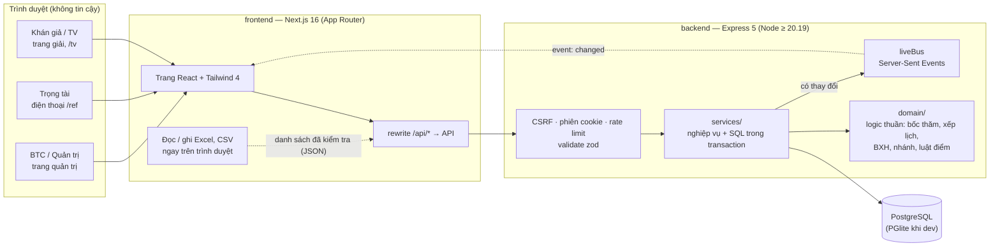
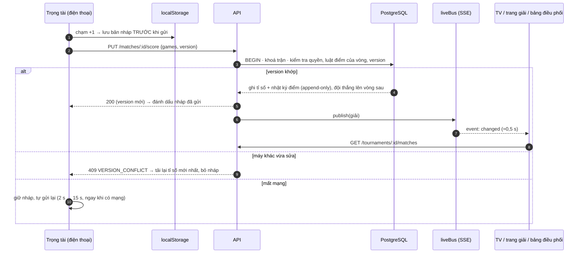
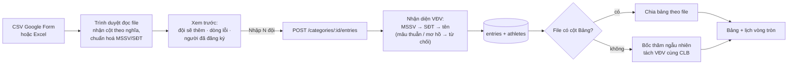

# SmashTeam Tournament

Last updated: 2026-11-18 11:04 PM CST

Web quản lý giải cầu lông **phong trào / mở rộng**, chạy độc lập: từ nhận đăng ký, bốc thăm, xếp lịch, điều phối sân, trọng tài chấm điểm trên điện thoại cho tới bảng xếp hạng, nhánh loại trực tiếp và màn hình chiếu tại nhà thi đấu. Mục tiêu: **BTC điều hành nhanh, gọn, ít thao tác** trong ngày thi đấu.

> Chưa có badge CI vì repo chưa có remote. Sau khi đẩy lên GitHub, thêm badge từ workflow `.github/workflows/ci.yml` (`…/actions/workflows/ci.yml/badge.svg`).

## Contents

- [Giới thiệu](#giới-thiệu)
- [Tính năng chính](#tính-năng-chính)
- [Kiến trúc](#kiến-trúc)
- [Luồng dữ liệu](#luồng-dữ-liệu)
- [Mô hình dữ liệu](#mô-hình-dữ-liệu)
- [Cấu trúc thư mục](#cấu-trúc-thư-mục)
- [Chạy trên máy](#chạy-trên-máy)
- [Cấu hình](#cấu-hình)
- [Triển khai & tài khoản đầu tiên](#triển-khai--tài-khoản-đầu-tiên)
- [Quy trình một giải](#quy-trình-một-giải)
- [API](#api)
- [Kiểm thử](#kiểm-thử)
- [Bảo mật](#bảo-mật)
- [Troubleshooting](#troubleshooting)
- [Giới hạn đã biết](#giới-hạn-đã-biết)
- [Tài liệu liên quan](#tài-liệu-liên-quan)

## Giới thiệu

Giải phong trào thường chạy bằng Google Form + Excel + giấy dán tường: trễ giờ là lịch vỡ, VĐV đánh 2 nội dung bị gọi 2 sân cùng lúc, tỉ số chuyền tay. Web này gom cả ngày thi đấu vào một chỗ:

| Ai | Dùng ở đâu | Làm gì |
|---|---|---|
| **Khán giả, VĐV** | Trang giải, màn hình TV — không cần đăng nhập | Xem lịch, sân nào đang đánh, tỉ số trực tiếp, bảng xếp hạng, nhánh đấu |
| **Trọng tài** | Điện thoại (`/ref`) | Chạm nửa màn hình để ghi điểm; được báo bên giao, ô giao, giờ nghỉ, đổi sân; mất mạng vẫn chấm tiếp |
| **Ban tổ chức (BTC)** | Trang quản trị giải | Nhập danh sách từ Excel / Google Form, bốc thăm, xếp lịch, gọi trận vào sân trống, truất quyền, sửa tỉ số |
| **Quản trị viên** | `/accounts`, `/new` | Tạo giải, cấp tài khoản cho BTC / trọng tài |

Mỗi giải là một trang `/t/<slug>` với 3 tab: **Lịch thi đấu**, **Bảng đấu**, **Loại trực tiếp**; ô **tìm tên VĐV** (không cần gõ dấu) lọc lịch và bảng đấu.

<sub>[↑ Back to contents](#contents)</sub>

## Tính năng chính

- **Đăng ký**: nhập thẳng file CSV tải từ Google Form hoặc Excel (nhận cột theo nghĩa, ô chọn nhiều nội dung, cột đồng đội); xem trước, báo dòng lỗi, bỏ qua người đã đăng ký; xuất lại ra Excel.
- **Nhận diện VĐV bằng MSSV + SĐT**: một người đánh nhiều nội dung là một hồ sơ; hai người trùng tên không bị gộp.
- **Chia bảng**: bốc thăm ngẫu nhiên (CSPRNG, tách VĐV cùng CLB, bốc lại luôn ra cách chia khác) hoặc lấy bảng có sẵn trong file.
- **Luật điểm theo vòng**: vd vòng bảng 11 điểm 1 game, loại trực tiếp 15 điểm, chung kết 21 điểm BWF.
- **Xếp lịch & điều phối sân**: lịch dự kiến không cho 1 VĐV đánh 2 sân cùng lúc; ngày thi đấu gọi trận theo **sân trống** với gợi ý trận kế tiếp (VĐV rảnh, đã nghỉ đủ), dời từng trận, trọng tài phụ trách sân.
- **Bàn điểm trọng tài**: bên giao + ô giao, nhắc nghỉ 60 s / 2 phút và đổi sân, hoàn tác, chịu được mất mạng, chống 2 máy ghi đè nhau.
- **Kết quả**: bảng xếp hạng (thắng → đối đầu → hiệu số game → hiệu số điểm → bốc thăm phụ), nhánh loại trực tiếp tự đưa đội thắng lên vòng sau, truất quyền / huỷ truất quyền.
- **Công khai, trực tiếp**: trang giải và **màn hình TV** cập nhật ~0,5 giây sau mỗi điểm (Server-Sent Events).
- **Giao diện sáng**, dùng tốt trên điện thoại, đạt tương phản WCAG AA.

Danh sách đầy đủ, phân quyền và mọi quy tắc nghiệp vụ: **[docs/FEATURES.md](docs/FEATURES.md)**.

<sub>[↑ Back to contents](#contents)</sub>

## Kiến trúc

Hai tiến trình Node + một PostgreSQL. Trình duyệt chỉ nói chuyện với **một origin** (Next.js); `/api/*` được Next proxy sang API, nên cookie phiên `httpOnly` + kiểm tra `Origin` hoạt động mà không cần CORS.



| Lớp | Trách nhiệm | Ghi chú |
|---|---|---|
| `frontend/app` | Giao diện; toàn bộ đọc/ghi Excel–CSV (server không nhận file); bản nháp điểm của trọng tài trong `localStorage` | Không có token nào trong JS — chỉ cookie `httpOnly` |
| `backend/src/app.js` | Định tuyến HTTP, CSRF, phiên, rate limit, lỗi `application/problem+json` | Mọi body / query qua schema zod (`schemas.js`) |
| `backend/src/services/` | Nghiệp vụ: giải, nội dung, đội, trận (`tournamentService`), điều phối sân (`courtService`), hồ sơ VĐV (`athleteService`), tài khoản (`userService`) | Mỗi thao tác ghi = 1 transaction; khoá hàng `FOR UPDATE`; khoá lạc quan theo `version` cho tỉ số |
| `backend/src/domain/` | Logic thuần, không I/O → test nhanh, tất định | Bốc thăm, vòng tròn, xếp lịch tham lam, BXH, nhánh, luật điểm, luật theo vòng |
| `backend/src/liveBus.js` | Báo "giải X vừa đổi" tới các kết nối SSE | Không mang dữ liệu — client gọi lại API, quyền xem không đổi |
| PostgreSQL | Nguồn sự thật duy nhất | Nhật ký điểm và nhật ký BTC **append-only** (trigger chặn sửa/xoá) |

<sub>[↑ Back to contents](#contents)</sub>

## Luồng dữ liệu

### 1. Trọng tài ghi điểm → mọi màn hình cập nhật



### 2. Đăng ký từ Google Form → bảng đấu



### 3. Một ngày thi đấu

1. **Xếp lịch dự kiến** cho vòng bảng (giờ bắt đầu, số sân, phút/trận); chống trùng VĐV giữa các nội dung theo **hồ sơ VĐV**.
2. **Điều phối sân**: sân trống → hệ thống gợi ý trận kế tiếp → BTC **Gọi vào sân** (công khai hiện "MỜI RA SÂN"). Trễ giờ thì cứ gọi theo sân trống; lịch giờ chỉ là dự kiến.
3. **Trọng tài** của sân mở `/ref`, chấm điểm theo luật của vòng → kết quả tự vào BXH.
4. Hết vòng bảng → **Tạo nhánh** (hạng nhất/nhì các bảng tách hai nửa nhánh) → xếp lịch loại trực tiếp → điều phối tiếp tới chung kết.

<sub>[↑ Back to contents](#contents)</sub>

## Mô hình dữ liệu

Database riêng của web giải (migration `backend/migrations/001` → `007`). Bảng chính:

| Bảng | Nội dung |
|---|---|
| `users`, `tournament_staff` | Tài khoản (admin / user); vai trò BTC / trọng tài theo từng giải |
| `tournaments` → `categories` | Giải → nội dung (MS, XD…), luật điểm mặc định + `round_rules` theo vòng |
| `athletes` | Hồ sơ VĐV theo giải: họ tên, MSSV, SĐT, email (dữ liệu cá nhân, chỉ BTC thấy) |
| `entries` | Đội / VĐV đăng ký một nội dung, trỏ tới 1–2 hồ sơ `athletes` |
| `groups`, `group_members` | Bảng đấu |
| `matches` | Trận vòng bảng và loại trực tiếp: sân, giờ, `called_at` (đã gọi vào sân), tỉ số, `version` |
| `court_referees` | Trọng tài phụ trách từng sân |
| `match_score_events`, `tournament_events` | Nhật ký điểm và nhật ký thao tác BTC — append-only |

Sơ đồ quan hệ đầy đủ: [docs/FEATURES.md § Mô hình dữ liệu](docs/FEATURES.md#11-mô-hình-dữ-liệu).

<sub>[↑ Back to contents](#contents)</sub>

## Cấu trúc thư mục

```text
smashteam-tournament/
├── backend/
│   ├── migrations/        001_init … 007_round_rules (SQL, idempotent)
│   ├── scripts/           migrate.js · seed-demo.js · create-user.js
│   ├── src/
│   │   ├── app.js         định tuyến HTTP
│   │   ├── auth.js        mật khẩu scrypt, phiên, CSRF
│   │   ├── config.js      đọc & kiểm tra biến môi trường (fail closed)
│   │   ├── db.js          pg Pool hoặc PGlite (dev)
│   │   ├── liveBus.js     Server-Sent Events
│   │   ├── schemas.js     schema zod
│   │   ├── domain/        logic thuần
│   │   └── services/      nghiệp vụ + SQL
│   └── test/              node:test (PGlite + Postgres thật)
├── frontend/
│   └── app/
│       ├── t/[slug]/      trang giải, /groups, /bracket, /tv, /admin/*
│       ├── ref/           bàn điểm trọng tài
│       ├── login/ accounts/ new/
│       ├── components/    UI dùng chung
│       └── lib/           api, excel, scoring, serve, useLive…
├── docs/                  FEATURES.md · ANALYSIS.md
├── docker-compose.yml     Postgres cho dev
└── .github/workflows/ci.yml
```

<sub>[↑ Back to contents](#contents)</sub>

## Chạy trên máy

Yêu cầu: **Node 20.19+**, và Docker (hoặc PostgreSQL 14+) — hoặc không cần gì thêm nếu dùng PGlite.

**Cách nhanh — không cần Postgres (PGlite, chỉ dev):**

```bash
cd backend && cp .env.example .env
```

Trong `backend/.env`: đặt `DATABASE_URL=pglite:.pgdata`, `DEV_LOGIN=1`, và `SESSION_SECRET` ≥ 32 ký tự (`openssl rand -base64 48`). Rồi:

```bash
cd backend && npm ci && npm run migrate && npm run seed:demo && npm run dev
```

```bash
cd frontend && cp .env.example .env.local && npm ci && npm run dev
```

Mở http://localhost:3100 → giải demo **Smash Open Cup 2026**. Trang `/login` có nút **Dev: Admin / Dev: Trọng tài** (đăng nhập 1 chạm). Seed cũng tạo tài khoản `dev-admin` / `dev-user` có mật khẩu (xem `DEV_PASSWORD` trong `backend/scripts/seed-demo.js`) để thử form đăng nhập thật.

**Với Postgres (Docker):**

```bash
docker compose up -d db
```

```bash
cd backend && npm ci && npm run migrate && npm run user:create -- --username admin --name "Ban tổ chức" --role admin && npm run dev
```

(`DATABASE_URL` mặc định trong `.env.example` trỏ tới Postgres của compose ở cổng 5433.)

<sub>[↑ Back to contents](#contents)</sub>

## Cấu hình

Backend đọc và kiểm tra cấu hình **một lần lúc khởi động**; thiếu / sai là dừng ngay và liệt kê từng biến.

| Biến | Nơi | Bắt buộc | Ý nghĩa |
|---|---|---|---|
| `DATABASE_URL` | backend | ✓ | `postgres://…`; `pglite:<thư mục>` chỉ khi dev (bị từ chối ở production) |
| `SESSION_SECRET` | backend | ✓ | ≥ 32 ký tự, ký cookie phiên. Lấy từ secret manager, không commit |
| `PUBLIC_ORIGIN` | backend | ✓ (prod) | Origin của web, vd `https://giai.example.com` (https ở production) — dùng kiểm tra CSRF |
| `NODE_ENV` | backend | | `development` / `test` / `production` |
| `PORT` | backend | | Mặc định `5100` |
| `LOG_LEVEL` | backend | | `debug` / `info` (mặc định) / `warn` / `error` — log JSON một dòng/sự kiện |
| `DEV_LOGIN` | backend | | `1` = nút đăng nhập dev. Bị từ chối ở production |
| `BACKEND_URL` | frontend | | Địa chỉ API cho proxy `/api/*`, mặc định `http://localhost:5100` |
| `NEW_USER_PASSWORD` | `user:create` | | Mật khẩu cho tài khoản tạo bằng CLI; bỏ trống = sinh ngẫu nhiên, in 1 lần |

<sub>[↑ Back to contents](#contents)</sub>

## Triển khai & tài khoản đầu tiên

1. Tạo database PostgreSQL riêng; đặt các biến ở [Cấu hình](#cấu-hình) qua secret manager của nền tảng.
2. Backend: `npm ci && npm run migrate && npm start`. Frontend: `npm ci && npm run build && npm start` (đặt `BACKEND_URL`).
3. Tạo **quản trị viên đầu tiên** trên máy chủ:
   `NEW_USER_PASSWORD='<mật khẩu>' npm run user:create -- --username admin --name "Ban tổ chức" --role admin`
   — chạy lại với cùng username = đặt lại mật khẩu và mở khoá.
4. Quản trị viên đăng nhập `/login` → **Tài khoản** tạo tài khoản cho BTC, trọng tài. Không có đăng ký công khai.
5. Reverse proxy / CDN: **tắt buffering cho `/api/tournaments/*/stream`** (SSE), nếu không trang vẫn chạy nhưng chỉ tự làm mới 10–15 giây.

Nâng cấp từ bản cũ dùng SSO SmashTeam: migration `004` giữ nguyên user, BTC, nhật ký; user cũ chưa có tên đăng nhập / mật khẩu thì quản trị viên đặt ở `/accounts`.

<sub>[↑ Back to contents](#contents)</sub>

## Quy trình một giải

1. **Tạo giải** (quản trị viên) → **Quản trị › Nội dung & VĐV**: thêm nội dung (mã, đơn/đôi, số bảng, số đội đi tiếp, luật điểm mặc định) và **Luật điểm theo vòng** nếu cần.
2. **Nhập Excel / CSV** (file Google Form hoặc File mẫu) → xem trước → nhập. Kiểm tra / sửa MSSV, SĐT ở **Quản trị › Vận động viên**.
3. **Bốc thăm** (hoặc chia bảng theo file) → **Ban tổ chức**: thêm trọng tài → **Xếp lịch sân › Vòng bảng** → **Công bố** giải.
4. Ngày thi đấu: **Điều phối sân** — giao trọng tài cho từng sân, sân trống → **Gọi vào sân**; trọng tài chấm điểm ở `/ref`; mở **Chiếu màn hình** (`/t/<slug>/tv`) trên TV.
5. Hết vòng bảng → **Tạo nhánh loại trực tiếp** → **Xếp lịch sân › Loại trực tiếp** → điều phối tới chung kết.
6. Sai tỉ số → **Mở lại** trận (khi trận vòng sau chưa bắt đầu). Vi phạm → **Truất quyền** (có lý do, ghi nhật ký).

<sub>[↑ Back to contents](#contents)</sub>

## API

Tiền tố `/api`. Request ghi phải có header `X-Requested-With: fetch`. Lỗi trả `application/problem+json` (`status`, `code`, `title`, `issues`).

| Nhóm | Endpoint chính | Quyền |
|---|---|---|
| Đăng nhập | `POST /auth/login` · `/auth/logout` · `GET /me` · `POST /me/password` | — / đã đăng nhập |
| Tài khoản | `GET POST /admin/users` · `PATCH /admin/users/:id` | quản trị viên |
| Giải | `GET /tournaments` · `/tournaments/:slug` · `POST /tournaments` · `PATCH /tournaments/:id` | công khai / quản trị viên / BTC |
| BTC & nhật ký | `GET PUT DELETE /tournaments/:id/staff[/:userId]` · `GET /tournaments/:id/events` · `GET /users?q=` | BTC |
| Nội dung | `POST /tournaments/:id/categories` · `PATCH DELETE /categories/:id` · `PUT /categories/:id/round-rules` | BTC |
| Đội & VĐV | `POST /categories/:id/entries` · `PATCH DELETE /entries/:id` · `POST /entries/:id/disqualify\|reinstate` · `GET /tournaments/:id/athletes` · `PATCH /athletes/:id` | BTC |
| Bảng & nhánh | `POST /categories/:id/draw\|swap\|knockout` · `GET /categories/:id/entries\|standings\|bracket` | BTC / công khai |
| Lịch & sân | `POST /tournaments/:id/schedule` · `GET /tournaments/:id/courts` · `PUT /tournaments/:id/courts/:court/referee` · `POST /matches/:id/call\|uncall` · `PATCH /matches/:id` | BTC |
| Trận & điểm | `GET /tournaments/:id/matches` · `GET /matches/:id` · `GET /referee/queue` · `PUT /matches/:id/score` · `POST /matches/:id/reopen` · `PUT /matches/:id/referee` | công khai / trọng tài / BTC |
| Trực tiếp | `GET /tournaments/:id/stream` (Server-Sent Events) | công khai (giải nháp: BTC) |

Tham số, body và quy tắc của từng endpoint: [docs/FEATURES.md § API](docs/FEATURES.md#10-api).

<sub>[↑ Back to contents](#contents)</sub>

## Kiểm thử

```bash
cd backend && npm test
```

Chạy domain, cấu hình, service và HTTP end-to-end trên **PGlite** — không cần cài Postgres (108 test). Thêm bộ test service với Postgres thật:

```bash
cd backend && TEST_PG_HOST=localhost TEST_PG_PORT=5433 TEST_PG_DB=tournament_test npm test
```

`TEST_PG_DB` phải chứa chữ `test` (DB bị xoá sạch). Frontend: `npm run typecheck`, `npm run lint`, `npm run build`. CI (`.github/workflows/ci.yml`) chạy các bước trên cho cả hai phía cùng `npm audit`.

Test quy tắc hai nút Bắt đầu / Hoàn thành trên giao diện (dùng TypeScript đã cài, không thêm thư viện): chạy `node --test test/matchControls.test.mjs` từ thư mục `frontend`.

<sub>[↑ Back to contents](#contents)</sub>

## Bảo mật

- **Mật khẩu** scrypt (salt riêng), so sánh thời gian hằng; sai tên / sai mật khẩu cùng một lỗi và cùng thời gian; giới hạn 20 lần / 15 phút / IP.
- **Phiên** cookie `httpOnly; SameSite=Lax; Secure` (prod), 12 giờ; vai trò, trạng thái khoá và `session_version` đọc lại từ DB mỗi request → đổi mật khẩu / khoá tài khoản là đăng xuất mọi phiên cũ ngay.
- **CSRF**: header tuỳ biến + kiểm tra `Origin`. Header bảo mật (CSP, `nosniff`, `frame-ancestors 'none'`, HSTS).
- **Dữ liệu cá nhân** (MSSV, SĐT, email) chỉ trả cho BTC; nhật ký sửa hồ sơ không ghi giá trị; hồ sơ không còn ở đội nào bị xoá. File Excel xuất có MSSV/SĐT — BTC tự bảo quản.
- **Excel / CSV xử lý trên trình duyệt**: server không có endpoint nhận file.
- Mọi query tham số hoá, mọi input qua zod; nhật ký điểm và nhật ký BTC append-only; bí mật chỉ qua biến môi trường / secret manager, không commit `.env`.

Chi tiết: [docs/FEATURES.md § Đăng nhập & bảo mật](docs/FEATURES.md#9-đăng-nhập--bảo-mật).

<sub>[↑ Back to contents](#contents)</sub>

## Troubleshooting

| Triệu chứng | Nguyên nhân / cách xử lý |
|---|---|
| API thoát ngay: `Cấu hình không hợp lệ` | Thiếu/sai env — thông báo liệt kê từng biến ([Cấu hình](#cấu-hình)) |
| Đăng nhập báo "Sai tên đăng nhập hoặc mật khẩu" dù đúng | Tài khoản bị khoá hoặc chưa có mật khẩu (user từ bản SSO cũ) → quản trị viên đặt ở `/accounts` |
| Quên mật khẩu quản trị viên duy nhất | `npm run user:create -- --username <tên> --role admin` trên máy chủ |
| Đăng nhập báo "Thử quá nhiều lần" (429) | Quá 20 lần / 15 phút từ một IP — đợi rồi thử lại |
| Ghi dữ liệu trả 403 `CSRF` | Gọi API thiếu `X-Requested-With: fetch`, hoặc `PUBLIC_ORIGIN` khác domain đang mở |
| Nhập file báo "Không tìm thấy dòng tiêu đề" | Dòng tiêu đề phải nằm trong 10 dòng đầu, có cột họ tên — dùng **File mẫu** |
| CSV lỗi dấu tiếng Việt | File không phải UTF-8: Google Form → Tải xuống .csv; Excel → *Lưu thành → CSV UTF-8* |
| Nhập báo "Có N VĐV tên X — nhập MSSV hoặc SĐT" | Nhiều người trùng tên trong giải; thêm MSSV/SĐT vào dòng đó |
| Nhập báo "MSSV … là của A nhưng SĐT … là của B" | Một trong hai bị gõ nhầm — kiểm tra ở **Vận động viên** |
| Có cột Bảng mà không chia bảng theo file | Nội dung đã có đội từ trước, có dòng thiếu Bảng, hoặc bảng chỉ 1 đội — xem lỗi trong hộp Xem trước |
| Nhập báo "đã bốc thăm" | Nội dung đó đã bốc thăm, không nhận thêm đội |
| Gọi trận báo "Sân N đang có trận" / "X đang ở sân N" | Sân hoặc VĐV đang bận — kết thúc / **Rút về** trận kia, hoặc chọn sân khác |
| Không **Rút về** được trận | Trận đã có điểm — dùng **Chuyển sân** |
| Bàn điểm báo "Mất kết nối — điểm đã lưu trên máy này" | Bình thường khi wifi chập chờn: cứ chấm tiếp, điểm tự gửi khi có mạng; đừng xoá dữ liệu trình duyệt trước khi thấy "Đã lưu" |
| Bàn điểm báo "đã bỏ bản nháp trên máy này" | Máy khác đã sửa trận lúc máy này mất mạng — giữ tỉ số máy chủ, kiểm tra với trọng tài kia |
| Trọng tài thấy "đã tải lại bản mới nhất" | Hai máy cùng nhập 1 trận (409) — thống nhất 1 máy/trận hoặc giao trọng tài theo sân |
| Bàn điểm báo sai bên giao | Bấm **Sửa bên giao** (bên giao lưu trên máy trọng tài; đổi máy giữa trận thì chọn lại) |
| Lưu luật theo vòng / sửa luật mặc định báo "đã có trận bắt đầu" | Vòng đó đã có trận đang đánh hoặc có kết quả — chỉ đổi được vòng chưa đánh |
| Sửa nội dung báo `CATEGORY_LOCKED` | Đơn/đôi khoá khi đã có đội; số bảng khoá khi đã bốc thăm |
| Không tạo được nhánh | Còn trận vòng bảng chưa kết thúc — xem tên bảng trong thông báo |
| Không mở lại được trận | Trận vòng sau đã bắt đầu, hoặc đã tạo nhánh (với trận vòng bảng) |
| Xếp lịch báo "Giờ bắt đầu đã qua" | Chọn giờ trong tương lai; giờ khai mạc đã qua thì phải nhập giờ bắt đầu |
| Trang giải / TV không hiện "Trực tiếp" | Proxy/CDN đang buffer SSE — tắt buffering cho `/api/*/stream`; trang vẫn tự làm mới 10–15 giây |
| `npm run migrate` / `seed:demo` báo khoá DB (PGlite) | PGlite chỉ cho 1 tiến trình mở thư mục DB — dừng API trước |
| Trang vẫn hiện màu / font cũ (dev) | Cache dev của Next — dừng web, xoá `frontend/.next`, chạy lại `npm run dev` |

<sub>[↑ Back to contents](#contents)</sub>

## Giới hạn đã biết

- Kênh trực tiếp (SSE) và rate limit nằm trong bộ nhớ → đúng với **1 instance API**; nhiều instance cần Postgres LISTEN/NOTIFY hoặc Redis (client có polling dự phòng nên chỉ chậm hơn, không sai).
- Bên giao cầu chỉ lưu trên máy trọng tài; đánh đôi chỉ báo bên + ô giao, không theo dõi VĐV nào giao.
- Bỏ cuộc tính thắng, không tính game/điểm đã đánh.
- Số bảng lẻ (vd 3 bảng × 2): có thể gặp lại đội cùng bảng ở vòng 2.
- Không đổi số bảng sau khi bốc thăm.
- Chưa có đăng ký online / thu phí, chưa có "quên mật khẩu" qua email (quản trị viên đặt lại).

<sub>[↑ Back to contents](#contents)</sub>

## Tài liệu liên quan

- [docs/FEATURES.md](docs/FEATURES.md) — toàn bộ chức năng, phân quyền, quy tắc nghiệp vụ, API chi tiết, sơ đồ dữ liệu.
- [CHANGELOG.md](CHANGELOG.md) — lịch sử thay đổi.
- [CONTRIBUTING.md](CONTRIBUTING.md) — quy ước nhánh, commit và pull request.
- [AGENTS.md](AGENTS.md) — quy tắc viết code cho người và AI agent (lệnh kiểm tra, backend, migration, frontend, bảo mật).
- [docs/ANALYSIS.md](docs/ANALYSIS.md) — phân tích ban đầu (thiết kế SSO cũ, đã thay thế; giữ làm tư liệu).

<sub>[↑ Back to contents](#contents)</sub>
