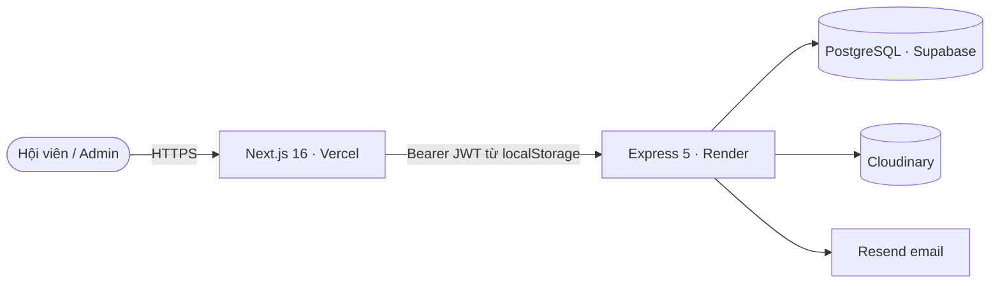
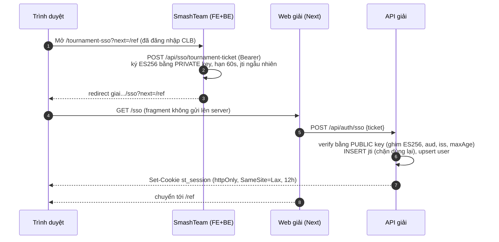
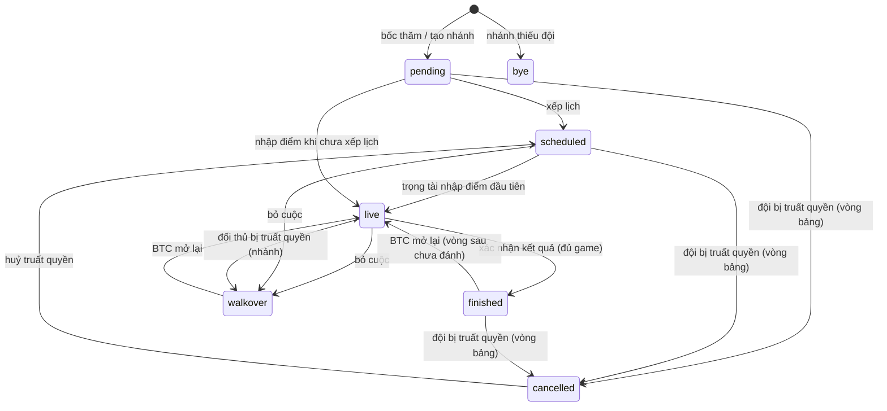

# Phân tích SmashTeam & đặc tả MVP Quản lý giải

Last updated: 2026-11-18 03:05 AM CST

> **Đã thay thế một phần (18/11/2026):** web giải nay chạy **độc lập** với tài khoản riêng (tên đăng nhập + mật khẩu). Thiết kế SSO từ SmashTeam, patch `integration/` và mọi phụ thuộc vào ELO/tài khoản CLB mô tả bên dưới **không còn dùng** — giữ lại làm tư liệu phân tích ban đầu. Hiện trạng: [FEATURES.md](FEATURES.md).

Nguồn đã đọc (18/11/2026): trang `https://www.smashteam.id.vn/` và repo `github.com/Taiyo1108/smashteam-badminton` (commit `63c323f`, 11/11/2026).

## 1. Breakdown website SmashTeam

| Khu vực | Nội dung hiện có | Ghi chú cho web giải |
|---|---|---|
| Trang chủ | Hero tuyển thành viên, KPI (146 vợt thủ, 842 trận, top ELO 1481), lịch tập T4/T5/T7 | — |
| Giải nổi bật | Thẻ "SMASH TEAM IV – Mùa giải 2026", đếm ngược, nút "Đăng ký thi đấu" | Lấy từ `club_events`; chỉ là **thông báo**, chưa có bảng đấu/lịch/điểm |
| Bảng xếp hạng | ELO 6 bậc (Bronze → Challenger), K-factor theo số trận | Dùng ELO làm **hạt giống** khi bốc thăm |
| Hoạt động / Media | Thư viện ảnh, vlog các giải I–III | — |
| Quản trị | Thành viên, buổi tập (QR check-in), trận đấu ELO, sự kiện, email, shop, nhiệm vụ | Không có module giải đấu |

## 2. Breakdown source code

- **Quy mô**: ~67k dòng JS/TS, 256 file; backend 16 route + 17 service; frontend App Router ~40 component.
- **Dữ liệu liên quan**: `users` (UUID, `role` admin/member/candidate/guest, `elo_score`), `matches` (trận đấu tập 1v1/2v2 tính ELO), `club_events` (giải/sự kiện: tiêu đề, ngày, địa điểm, `max_participants`, `status`).
- **Auth**: JWT HS256 (`JWT_SECRET`), payload `{id, role, name}`, hạn 7–30 ngày, lưu ở `localStorage`.

### Phát hiện cần lưu ý (đã kiểm chứng trong code)

| Mức | Phát hiện | Bằng chứng | Đề xuất |
|---|---|---|---|
| Cao | CORS cuối cùng luôn `callback(null, true)` → mọi origin đều được phép, kèm `credentials: true` | `backend/index.js` (dòng "Chấp nhận an toàn…") | Trả lỗi cho origin ngoài danh sách. Hiện ít nguy hiểm vì auth bằng Bearer chứ không phải cookie, nhưng là bẫy khi đổi sang cookie |
| Cao | Seed admin với mật khẩu đã biết `admin123` | `backend/db/schema.sql:50` | Xoá seed; tạo admin bằng script đọc mật khẩu từ secret manager |
| Trung bình | JWT 7–30 ngày lưu trong `localStorage` (XSS đọc được) | `frontend/app/utils/auth.ts:67` | Về lâu dài chuyển cookie httpOnly; app giải đã làm theo cách này |
| Trung bình | `/login?redirect=` gọi `router.push(redirect)` không kiểm tra → open redirect | `frontend/app/login/page.tsx:92` | Chỉ nhận đường dẫn bắt đầu bằng `/` và không phải `//` |
| Trung bình | Không có test runner/CI (`"test": "exit 1"`, test là script rời) | `backend/package.json` | Dùng `node --test` + GitHub Actions như repo giải |
| Thấp | Migration rải rác (`run_04.js`… + `.sql`) không có bảng phiên bản | `backend/db/migrations/` | Bảng `schema_migrations` như repo giải |

## 3. Vì sao tách web giải riêng (đã chọn)

- Ngày thi đấu cần **ổn định**: lỗi deploy CLB không được làm sập bàn trọng tài và ngược lại.
- Dữ liệu giải (bảng, trận, audit điểm) có vòng đời riêng; **DB riêng** giảm bán kính sự cố.
- Liên kết bằng **SSO một chiều**: SmashTeam là nguồn danh tính, web giải chỉ nhận ticket ký số.

## 4. Luồng SSO

Lý do chọn ES256 (bất đối xứng) thay vì dùng chung `JWT_SECRET`: web giải **không thể** tự ký ticket hay token CLB; lộ khoá ở web giải không ảnh hưởng CLB.

## 5. Đặc tả MVP

> Cập nhật 18/11/2026: giải chuyển sang **giải mở rộng** — bỏ ELO/hạt giống, bốc thăm ngẫu nhiên tách CLB, thêm truất quyền, đổi bảng, CRUD nội dung, trang Lịch thi đấu. Các dòng dưới đã sửa theo; danh sách chức năng đầy đủ ở [FEATURES.md](FEATURES.md).

**Vai trò**: admin CLB (toàn quyền) · BTC của giải · trọng tài của giải · khán giả (không cần đăng nhập).

| # | Tính năng | Ghi chú |
|---|---|---|
| 1 | Tạo giải, nội dung (MS/WS/MD/WD/XD…), luật điểm 21/30, 15/21, 11/15; BO3 hoặc 1 game | Admin CLB tạo; người tạo thành BTC |
| 2 | Nhập danh sách VĐV/cặp (dán nhiều dòng `tên / tên ; CLB`); BTC thêm / sửa / xoá nội dung | Giải mở rộng: không dùng ELO |
| 3 | Bốc thăm chia bảng **ngẫu nhiên**, tách đội cùng CLB; bốc lại luôn ra kết quả khác; sinh lịch **vòng tròn** (circle method) | Mỗi bảng ≥ 2 đội |
| 4 | Xếp lịch sân theo giai đoạn (vòng bảng / loại trực tiếp khác ngày): không VĐV nào đánh 2 sân cùng lúc, ưu tiên nghỉ 1 lượt, xếp cả nhánh một lần | Greedy tất định |
| 5 | BXH bảng: thắng → đối đầu (2 đội) → hiệu số game → hiệu số điểm → bốc thăm phụ | Tinh thần quy chế BWF, đơn giản hoá |
| 6 | Nhánh loại trực tiếp: nhất bảng gặp nhì bảng khác, cùng bảng ở 2 nửa nhánh; bye cho seed cao | Chuẩn seed 1-8-4-5-2-7-3-6 |
| 7 | Trọng tài nhập điểm từng quả trên điện thoại; tự sang game; xác nhận kết quả; bỏ cuộc | Optimistic locking `version` → 409 khi 2 máy cùng nhập |
| 8 | Đội thắng tự vào vòng sau; BTC mở lại trận để sửa nếu vòng sau chưa đánh; truất quyền (vòng bảng huỷ kết quả, nhánh xử W.O) | Nhật ký điểm + nhật ký BTC append-only |
| 9 | Trang công khai **Lịch thi đấu**: theo giờ / theo sân / dạng bảng / cây loại trực tiếp — tự làm mới 10s | Giao diện sáng theo web CLB, đỏ–đen |

### Vòng đời trận

### Ngoài phạm vi MVP (TODO kèm điều kiện kích hoạt)

| Hoãn lại | Kích hoạt khi |
|---|---|
| SSE/WebSocket thay polling 10s | > ~300 người xem cùng lúc hoặc cần độ trễ < 2s |
| CSP nonce (bỏ `'unsafe-inline'` script) | Trước khi cho phép nội dung do người dùng nhập hiển thị dạng HTML |
| Đẩy kết quả giải về ELO CLB | Khi BCN thống nhất hệ số K cho trận giải |
| Đăng ký thi đấu online + thu phí | Có tiền chuyển qua hệ thống → lên Tier 2 |
| Rate limit dùng chung (Redis/PG) | Chạy > 1 instance API |
| Bảng 3 đội đi tiếp, tránh gặp lại cùng bảng ở vòng 2 khi số bảng lẻ | Giải có ≥ 3 bảng lấy 2 đội |
