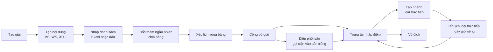
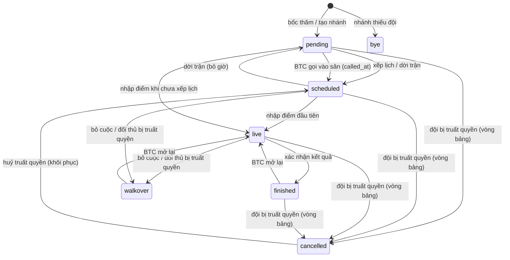
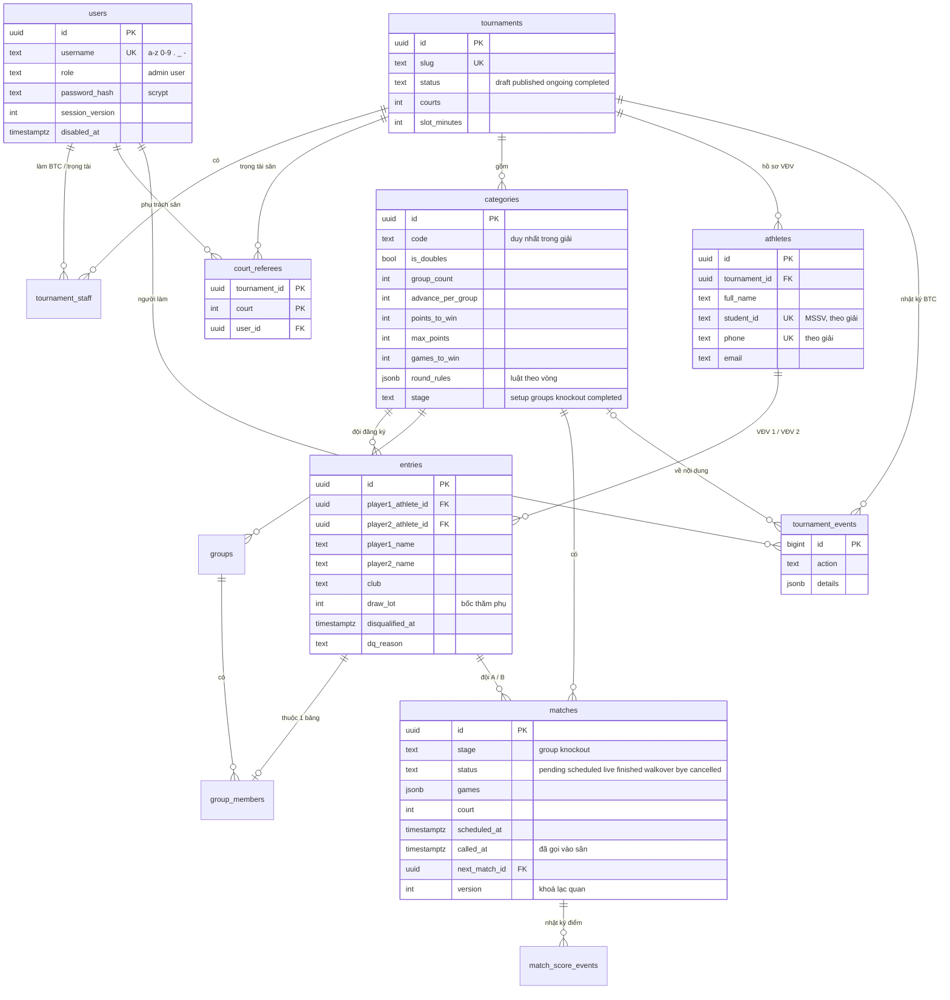

# Chức năng hệ thống — Smash Open Cup

Last updated: 2026-11-18 10:55 PM CST

Tài liệu mô tả **toàn bộ chức năng hiện có** của web quản lý giải cầu lông mở rộng *Smash Open Cup* (repo `smashteam-tournament`) — một web **độc lập**, có tài khoản riêng, không phụ thuộc hệ thống nào khác: ai dùng được gì, ở trang nào, theo quy tắc nào. Cách chạy & cấu hình: [README](../README.md). Phân tích ban đầu & lý do kiến trúc: [ANALYSIS.md](ANALYSIS.md).

## Contents

- [1. Tổng quan](#1-tổng-quan)
- [2. Vai trò & phân quyền](#2-vai-trò--phân-quyền)
- [3. Bản đồ trang](#3-bản-đồ-trang)
- [4. Chức năng công khai (khán giả, VĐV)](#4-chức-năng-công-khai-khán-giả-vđv)
- [5. Chức năng trọng tài](#5-chức-năng-trọng-tài)
- [6. Chức năng Ban tổ chức (quản trị giải)](#6-chức-năng-ban-tổ-chức-quản-trị-giải)
- [7. Quy tắc nghiệp vụ](#7-quy-tắc-nghiệp-vụ)
- [8. Nhật ký & kiểm soát](#8-nhật-ký--kiểm-soát)
- [9. Đăng nhập & bảo mật](#9-đăng-nhập--bảo-mật)
- [10. API](#10-api)
- [11. Mô hình dữ liệu](#11-mô-hình-dữ-liệu)
- [12. Giới hạn hiện tại](#12-giới-hạn-hiện-tại)

## 1. Tổng quan

Một giải đi qua các bước sau; mỗi bước là một màn hình của Ban tổ chức (BTC):

Khán giả theo dõi mọi lúc qua trang giải: **Lịch thi đấu · Bảng đấu · Loại trực tiếp** (không cần đăng nhập).

[↑ Back to contents](#contents)

## 2. Vai trò & phân quyền

| Vai trò | Là ai | Cách có |
|---|---|---|
| **Khán giả** | Bất kỳ ai | Không cần đăng nhập |
| **Trọng tài** | Người được BTC thêm vào một giải | Quản trị viên cấp tài khoản (vai trò *Người dùng*) → BTC thêm vào giải |
| **BTC (organizer)** | Ban tổ chức của một giải | Người tạo giải tự là BTC; BTC thêm BTC khác (cũng là tài khoản *Người dùng*) |
| **Quản trị viên** | Tài khoản vai trò `admin` | Toàn quyền mọi giải; là người duy nhất được **tạo giải** và **quản lý tài khoản**. Tài khoản admin đầu tiên tạo bằng lệnh `npm run user:create` |

Không có đăng ký công khai: mọi tài khoản do quản trị viên tạo (tránh người lạ tự lập tài khoản trong ngày thi đấu).

| Chức năng | Khán giả | Trọng tài | BTC | Quản trị viên |
|---|:-:|:-:|:-:|:-:|
| Xem giải đã công bố, lịch, bảng xếp hạng, nhánh | ✓ | ✓ | ✓ | ✓ |
| Xem giải đang ở trạng thái **Nháp** | — | — | ✓ | ✓ |
| Nhập điểm trận (được phân công hoặc chưa phân công) | — | ✓ | ✓ | ✓ |
| Tạo giải | — | — | — | ✓ |
| Sửa giải, đổi trạng thái | — | — | ✓ | ✓ |
| Thêm / sửa / xoá nội dung thi đấu | — | — | ✓ | ✓ |
| Nhập đội, bốc thăm, đổi bảng, sửa đội, truất quyền | — | — | ✓ | ✓ |
| Xếp lịch, phân công trọng tài, mở lại trận | — | — | ✓ | ✓ |
| Nhập / xuất danh sách VĐV bằng Excel | — | — | ✓ | ✓ |
| Quản lý BTC & trọng tài, xem nhật ký thao tác | — | — | ✓ | ✓ |
| Tạo / sửa / khoá tài khoản, đặt lại mật khẩu | — | — | — | ✓ |
| Tự đổi mật khẩu của mình | — | ✓ | ✓ | ✓ |

Quyền **luôn kiểm tra ở server** (đọc lại vai trò từ DB mỗi request); nút bị ẩn/tắt trên giao diện chỉ để tiện dùng.

[↑ Back to contents](#contents)

## 3. Bản đồ trang

| Đường dẫn | Trang | Ai vào |
|---|---|---|
| `/` | Trang chủ: banner giải, danh sách giải | Mọi người |
| `/t/<slug>` | Trang giải — tab **Lịch thi đấu** (theo giờ / theo sân / dạng bảng), khối Đang thi đấu | Mọi người |
| `/t/<slug>/groups` | Trang giải — tab **Bảng đấu** (bảng xếp hạng từng bảng) | Mọi người |
| `/t/<slug>/bracket` | Trang giải — tab **Loại trực tiếp** (dạng cây / dạng bảng) | Mọi người |
| `/t/<slug>/schedule` | Đường dẫn cũ → tự chuyển về `/t/<slug>` (giữ bộ lọc hợp lệ; `?view=tree` → tab Loại trực tiếp) | Mọi người |
| `/login` | Đăng nhập (tên đăng nhập + mật khẩu) | Mọi người |
| `/t/<slug>/tv` | **Màn hình chiếu** tại nhà thi đấu (TV / máy chiếu): tỉ số từng sân, "MỜI RA SÂN", trận sắp tới | Mọi người |
| `/accounts` | Tài khoản: đổi mật khẩu; quản trị viên thấy thêm danh sách tài khoản | Đã đăng nhập |
| `/ref` | Bàn trọng tài: danh sách trận được nhập điểm | Đã đăng nhập |
| `/ref/<matchId>` | Màn hình nhập điểm trên điện thoại | Trọng tài / BTC |
| `/new` | Tạo giải mới | Quản trị viên |
| `/t/<slug>/admin` | Quản trị — Tổng quan | BTC |
| `/t/<slug>/admin/categories` | Quản trị — Nội dung & VĐV | BTC |
| `/t/<slug>/admin/athletes` | Quản trị — **Vận động viên** (hồ sơ: MSSV, SĐT, email, nội dung đang đăng ký) | BTC |
| `/t/<slug>/admin/courts` | Quản trị — **Điều phối sân** (gọi trận, trọng tài sân, hàng chờ) | BTC |
| `/t/<slug>/admin/schedule` | Quản trị — Xếp lịch sân (lịch dự kiến) | BTC |
| `/t/<slug>/admin/matches` | Quản trị — Trận đấu & trọng tài | BTC |
| `/t/<slug>/admin/staff` | Quản trị — Ban tổ chức | BTC |
| `/t/<slug>/admin/log` | Quản trị — Nhật ký thao tác | BTC |

Thanh điều hướng nổi: logo · **Lịch thi đấu ▾** (mở danh sách giải để chọn: đang diễn ra → sắp diễn ra → nháp → đã kết thúc) · **Trọng tài** (chỉ tài khoản có nhiệm vụ trọng tài: vai trò trọng tài của giải, phụ trách sân, hoặc được gán trận) · nút tài khoản. **Menu tài khoản**: tên + vai trò, **Quản lý giải** (admin: mọi giải; BTC: giải mình là BTC → trang quản trị), **Tạo giải mới** (admin), **Quản lý tài khoản** (admin) / **Đổi mật khẩu**, chọn giao diện, đăng xuất; Esc hoặc bấm ra ngoài để đóng. Điện thoại: thanh trên còn logo + tài khoản, **thanh tab đáy** Trang chủ · Lịch đấu (bảng chọn giải trượt lên) · Trọng tài; ẩn ở màn nhập điểm `/ref/<id>`. Trang quản trị có sidebar đen riêng (thu thành nút ☰ trên điện thoại).

[↑ Back to contents](#contents)

## 4. Chức năng công khai (khán giả, VĐV)

### Trang chủ
- Banner Smash Open Cup 2026, nút tới giải đang diễn ra / sắp diễn ra.
- Danh sách giải (đang diễn ra có chấm đỏ nhấp nháy), ngày giờ, địa điểm.

### Trang giải `/t/<slug>`: một khung, ba tab
Đầu trang: tên giải, địa điểm, giờ khai mạc, nút **Quản lý giải** (BTC). Ba tab là **ba đường dẫn riêng** dùng chung một khung; chuyển tab giữ nguyên nội dung đang chọn (`?cat=`):

| Tab | Đường dẫn | Nội dung |
|---|---|---|
| **Lịch thi đấu** | `/t/<slug>` | Ô **tìm VĐV** · khối **Đang thi đấu** · lịch mọi trận (theo giờ / sân / bảng) |
| **Bảng đấu** | `/t/<slug>/groups` | Ô **tìm VĐV** · bảng xếp hạng từng bảng — mọi nội dung đã bốc thăm (mặc định) hoặc nội dung đang chọn |
| **Loại trực tiếp** | `/t/<slug>/bracket` | Nhánh của nội dung đang chọn: **dạng cây** (đường nối, đội thắng ✓ + đường đỏ, "Thắng trận X", ô **Vô địch**) hoặc **dạng bảng** |

**Tìm VĐV** (`?q=`, chia sẻ được; giữ nguyên khi chuyển giữa Lịch thi đấu ↔ Bảng đấu): gõ tên không cần dấu, không phân biệt hoa thường ("nguyen minh khoa"), hoặc tên CLB / trường; nhiều từ thì phải có đủ các từ ("an uit").
- **Lịch thi đấu**: chỉ còn trận của người đó (cả khối đang thi đấu); ô tóm tắt "3 trận · Nguyễn Minh Khoa · MS Bảng C · hạng 3" — bấm chip sang tab Bảng đấu.
- **Bảng đấu**: chỉ còn bảng có tên người đó, dòng của họ được tô vàng; bấm chip nhảy tới đúng bảng.
- Không thấy → gợi ý gõ ít chữ hơn / chọn "Tất cả nội dung" (VĐV chỉ có sau khi bốc thăm).

**Cập nhật trực tiếp**: có điểm mới, gọi trận vào sân, dời trận… → trang tải lại trong khoảng nửa giây (Server-Sent Events; dòng trạng thái hiện "Trực tiếp"). Mất kết nối → tự nối lại, trong lúc đó tự làm mới mỗi 10 giây. Nút **Chiếu màn hình** mở màn hình TV.

### Màn hình chiếu `/t/<slug>/tv`
Dành cho TV / máy chiếu tại nhà thi đấu (nền tối, chữ lớn, không thanh điều hướng, nút toàn màn hình):
- Mỗi sân một ô: **ĐANG ĐÁNH** (tỉ số game hiện tại cỡ lớn + các game đã xong) · **MỜI RA SÂN** (nhấp nháy, tên 2 đội) · Sân trống.
- Dải dưới: 8 trận **sắp tới** (giờ dự kiến, nội dung, 2 đội). Đồng hồ giờ Việt Nam; cập nhật trực tiếp như trang giải.

### Tab Lịch thi đấu
Cho biết **trận nào, đánh ở sân nào, lúc mấy giờ, tỉ số bao nhiêu**:

| Kiểu xem | Mô tả |
|---|---|
| **Theo giờ** | Mỗi khung giờ một hàng thẻ trận, sắp theo sân |
| **Theo sân** | Lưới: cột = sân, hàng = khung giờ — giống bảng phân sân dán tại nhà thi đấu; ô trống = sân rảnh |
| **Dạng bảng** | Mọi trận: giờ, sân, nội dung/vòng, 2 đội, tỉ số từng game, trạng thái. Trên điện thoại hiện dạng thẻ |

- Lọc theo **nội dung**, **ngày** (khi giải kéo dài nhiều ngày), **sân**.
- Bộ lọc nằm trên URL (vd `/t/<slug>?view=court&cat=MS&day=2026-11-26`, `/t/<slug>/bracket?cat=WS&view=table`) → gửi link là mở đúng màn hình, dùng chiếu màn hình lớn tại sân.
- Trận đang đánh: viền đỏ + nhãn "Đang đánh"; đội bị truất quyền: nhãn "Bị truất quyền"; trận bị huỷ không hiển thị.
[↑ Back to contents](#contents)

## 5. Chức năng trọng tài

- **Bàn trọng tài** `/ref`: danh sách trận mình được nhập — trận gán riêng cho mình, trận ở **sân mình phụ trách**, hoặc trận chưa có trọng tài thuộc giải mình làm trọng tài. Trận đang đánh / vừa được gọi vào sân lên đầu, ưu tiên sân của mình.
- **Nhập điểm** `/ref/<matchId>`: chạm nửa màn hình bên ghi điểm; tự nhận biết hết game theo **luật điểm của vòng đó** (hiện ở đầu màn hình, vd "11 điểm, trần 15 · 1 game" — xem [7.6](#76-tính-điểm)); hoàn tác; **Xác nhận kết quả** khi đủ số game thắng; **Bỏ cuộc** (chọn bên thắng).
- **Bên giao cầu & ô giao**: đầu trận hỏi "Bên nào giao cầu trước?" (bốc thăm / tung cầu). Sau đó tự theo luật rally: bên thắng pha cầu giao pha tiếp (kể cả đầu game sau); nhãn **"Giao cầu · ô PHẢI / TRÁI"** trên nửa màn hình của bên giao — điểm của bên giao **chẵn → ô phải, lẻ → ô trái**. **Hoàn tác** trả lại đúng bên giao trước đó; nút **Sửa bên giao** khi trọng tài bấm nhầm. Lưu trên máy trọng tài (không đồng bộ). Đánh đôi: chỉ báo bên + ô giao, không theo dõi VĐV nào giao.
- **Nhắc nghỉ & đổi sân** (thẻ đếm ngược, rung máy nếu điện thoại hỗ trợ): bên dẫn chạm **nửa số điểm thắng** (21 → 11, 15 → 8, 11 → 6) → **nghỉ 60 giây**; hết một game (chưa hết trận) → **nghỉ 2 phút, đổi sân**; **game quyết định** (game 3 của 2/3, game 5 của 3/5) chạm mốc nghỉ → **đổi sân**. Khi đổi sân, màn hình tự đổi bên trái/phải cho khớp vị trí VĐV.
- Hai máy cùng nhập một trận: máy chậm hơn nhận thông báo "đã tải lại bản mới nhất" (khoá lạc quan theo `version`), không ghi đè điểm của nhau.
- **Mất mạng không mất điểm**: mỗi lần chạm được lưu ngay vào bản nháp trên máy (`localStorage`) **trước khi** gửi. Mất kết nối → màn hình báo "điểm đã lưu trên máy này", tự gửi lại (2 s → tối đa 15 s, và ngay khi có mạng). Tải lại trang / mở lại máy → khôi phục điểm chưa gửi và lịch sử **Hoàn tác**. Nếu trong lúc đó máy khác đã sửa trận (version trên máy chủ đã khác) → **bỏ** bản nháp, không ghi đè, và báo cho trọng tài. Còn điểm chưa gửi thì chưa cho **Xác nhận kết quả**.
- Trọng tài **không** nhập được trận của giải còn Nháp, trận đã kết thúc, trận đã huỷ, trận đã phân công cho trọng tài khác (gán riêng cho trận, hoặc trọng tài phụ trách sân của trận).

[↑ Back to contents](#contents)

## 6. Chức năng Ban tổ chức (quản trị giải)

### 6.1 Tổng quan
- Thẻ số liệu: số nội dung, số đội đăng ký, trận đã xong / tổng, số trận đang đánh.
- Đổi **trạng thái giải**: Nháp (chỉ BTC thấy) → Công bố → Đang diễn ra (tự chuyển khi có điểm đầu tiên) → Đã kết thúc (khoá nhập điểm).
- Danh sách nội dung kèm giai đoạn; 6 thao tác gần nhất trong nhật ký.

### 6.2 Nội dung & VĐV
**CRUD nội dung thi đấu** (MS, WS, MD, WD, XD…):

| Thao tác | Được khi | Ghi chú |
|---|---|---|
| **Thêm** | Luôn | Mã (A–Z, 0–9, ≤10 ký tự, không trùng trong giải), tên, đơn/đôi, số bảng, số đội đi tiếp mỗi bảng, luật điểm (21/30 · 15/21 · 11/15), thể thức (2/3 game hoặc 1 game) |
| **Sửa mã, tên** | Luôn | |
| **Sửa đơn/đôi** | Chưa bốc thăm **và** chưa có đội | |
| **Sửa số bảng, số đội đi tiếp** | Chưa bốc thăm | |
| **Sửa luật điểm mặc định, thể thức** | Chưa có trận đã bắt đầu nào **đang dùng luật mặc định** (vòng có luật riêng không bị ảnh hưởng) | |
| **Luật điểm theo vòng** | Từng vòng: chưa có trận đã bắt đầu ở vòng đó | Xem [7.6](#76-tính-điểm) |
| **Xoá** | Chưa trận nào bắt đầu | Phải gõ đúng mã để xác nhận; xoá kèm đội, bảng, lịch; **nhật ký vẫn giữ** |

Trường bị khoá hiện mờ kèm lý do; server kiểm tra lại (lỗi 409 `CATEGORY_LOCKED` / `CATEGORY_STARTED`).

**Đội / VĐV:**
- **Nhập / xuất Excel / CSV Google Form** (khung *Excel* đầu trang), xem [6.8](#68-nhập--xuất-excel--csv). Mỗi VĐV gắn với một **hồ sơ** — xem [6.9](#69-vận-động-viên) và [7.10](#710-nhận-diện-vđv).
- **Dán danh sách đăng ký**: mỗi dòng `tên ; CLB ; MSSV ; SĐT` (đôi: `tên A / tên B ; CLB ; MSSV A / MSSV B ; SĐT A / SĐT B`); chỉ tên bắt buộc. Có MSSV/SĐT thì không mất định danh khi phải dán tay thay vì nhập file. Chỉ khi chưa bốc thăm.
- **Xoá đội**: chỉ khi chưa bốc thăm.
- **Sửa đội** (thay VĐV, đổi đồng đội, đổi CLB): khi đội chưa thi đấu trận nào.
- **Bốc thăm** chia bảng (xem [7.1](#71-bốc-thăm-ngẫu-nhiên)) và **Bốc thăm lại** (xác nhận trong hộp thoại).
- **Đổi bảng**: đổi chỗ 2 đội ở 2 bảng khác nhau; lịch vòng tròn của 2 bảng đó được tạo lại. Chỉ khi 2 bảng chưa có trận bắt đầu.
- **Truất quyền** (bắt buộc ghi lý do) và **Huỷ truất quyền** — xem [7.4](#74-truất-quyền-thi-đấu).
- **Tạo nhánh loại trực tiếp** khi mọi bảng đã đánh xong.
- Cột **Thăm**: số bốc thăm phụ của đội (dùng phá hoà cuối cùng ở bảng xếp hạng).

### 6.3 Điều phối sân (ngày thi đấu)
Màn hình BTC dùng suốt ngày thi đấu — **lịch giờ chỉ là dự kiến, sân trống thì gọi trận kế tiếp** (xem [7.9](#79-điều-phối-sân)). Tự cập nhật mỗi 5 giây.

| Thẻ sân | Thao tác |
|---|---|
| **Trống** | Hiện **gợi ý trận kế tiếp** (cả 2 đội rảnh, đã nghỉ đủ) → **Gọi vào sân**; hoặc **Trận khác** để chọn từ hàng chờ |
| **Đã gọi** (vàng, kèm số phút đã chờ) | **Bàn điểm** · **Chuyển sân** · **Rút về** hàng chờ (khi chưa có điểm) |
| **Đang đánh** (đỏ, kèm tỉ số và số phút trên sân) | **Bàn điểm** · **Chuyển sân** (điểm giữ nguyên) |

- Mỗi sân có ô **Trọng tài sân**: giao một trọng tài phụ trách cả sân — mọi trận vào sân đó (chưa gán trọng tài riêng) thuộc người này.
- **Hàng chờ**: mọi trận đủ 2 đội chưa vào sân, sắp theo giờ dự kiến; nhãn đỏ "X đang ở sân N" (không gọi được), nhãn vàng "Nghỉ thêm ~N′"; gọi nhanh vào sân trống bất kỳ, hoặc **Dời** (đồng hồ).
- Lỗi (sân đang bận, VĐV đang ở sân khác…) hiện ngay trong hộp thoại, giữ nguyên lựa chọn.
- Khán giả thấy trận đã gọi với nhãn vàng **"Mời ra sân"** trên lịch thi đấu.

### 6.4 Xếp lịch sân (lịch dự kiến)
Hai biểu mẫu độc lập (xem [7.5](#75-xếp-lịch-sân)):
- **Vòng bảng**: giờ bắt đầu (bỏ trống = giờ khai mạc), số sân, phút/trận.
- **Loại trực tiếp**: **bắt buộc** ngày giờ (có thể khác ngày vòng bảng), số sân, phút/trận.

Số sân / phút mỗi trận chỉ áp cho lần xếp đó, không đổi cấu hình giải. Báo số trận đã xếp và giờ dự kiến xong.

### 6.5 Trận đấu & trọng tài
- Lọc theo trạng thái (Tất cả / Đang đánh / Sắp đánh / Kết thúc / Đã huỷ) và nội dung.
- **Phân công trọng tài** từng trận (hoặc "Ai cũng được" — khi đó trọng tài phụ trách sân sẽ chấm).
- **Dời** một trận: đổi giờ dự kiến và/hoặc sân mà không phải xếp lại cả giai đoạn. Chặn trùng sân hoặc trùng VĐV trong cùng khung giờ (± số phút mỗi trận). Trận đang ở sân chỉ **chuyển sân**.
- **Nhập điểm** (mở bàn trọng tài) hoặc **Mở lại** trận đã kết thúc để sửa tỉ số — xem [7.7](#77-mở-lại-trận).

### 6.6 Ban tổ chức & trọng tài
- **Tài khoản trọng tài** — BTC tự quản lý, không cần nhờ quản trị viên:
  - **Tạo**: họ tên → tên đăng nhập tự gợi ý ("Nguyễn Thị Lan" → `lan.nguyen`, sửa được), mật khẩu sinh ngẫu nhiên → tạo xong vào giải làm trọng tài ngay; hộp thoại hiện **tên đăng nhập + mật khẩu một lần** kèm nút **Sao chép** để gửi cho trọng tài.
  - **Danh sách**: tên, `@tên đăng nhập`, lần đăng nhập cuối (hoặc "chưa đăng nhập lần nào"), sân phụ trách, số trận, số giải khác đang làm; nhãn **Đã khoá** / **Chưa có mật khẩu**.
  - **Sửa**: đổi tên · **đặt lại mật khẩu** (hiện mật khẩu mới một lần) · **khoá / mở khoá**. Đặt lại mật khẩu hoặc khoá → mọi thiết bị đang đăng nhập bị đăng xuất.
  - **Gỡ khỏi giải**: bỏ vai trò trọng tài và phụ trách sân ở giải này (trận đã chấm giữ nguyên). Nếu người đó không còn làm ở giải nào khác → **tài khoản bị khoá** (không xoá cứng, mở khoá lại được).
  - **Phạm vi quyền**: BTC chỉ sửa được tài khoản thường **không là BTC ở đâu** và **mọi giải người đó đang làm đều do BTC này quản lý** — BTC giải A không chiếm được tài khoản trọng tài đang làm cho giải B của người khác (với tài khoản đó chỉ có nút Gỡ). Quản trị viên sửa được mọi trọng tài. Mật khẩu không bao giờ ghi vào nhật ký.
- **Thêm tài khoản có sẵn**: tìm theo tên hoặc tên đăng nhập → thêm làm **Trọng tài** hoặc **BTC**. Tài khoản bị khoá không thêm được.
- **Ban tổ chức**: danh sách BTC của giải, gỡ được.

### 6.7 Nhật ký thao tác
- Mọi thao tác điều hành (xem [8](#8-nhật-ký--kiểm-soát)): thời gian, loại, nội dung, mô tả, người làm. Không sửa, không xoá được.

### 6.8 Nhập / xuất Excel / CSV
File `.xlsx` hoặc `.csv` được **đọc và tạo ngay trên trình duyệt**, không tải file lên máy chủ; chỉ danh sách đã kiểm tra mới gửi qua API thêm đội (server kiểm tra lại, và nhận diện VĐV theo [7.10](#710-nhận-diện-vđv)).

| Nút | Kết quả |
|---|---|
| **File mẫu** | `mau-danh-sach-vdv-<giải>.xlsx`: sheet *Danh sách* (cột `Nội dung · VĐV 1 · MSSV 1 · SĐT 1 · VĐV 2 · MSSV 2 · SĐT 2 · CLB · Bảng`, có dòng ví dụ) + sheet *Hướng dẫn* |
| **Nhập Excel / CSV** | Đọc file → hộp **Xem trước**: số đội sẽ thêm theo từng nội dung, bao nhiêu dòng có MSSV/SĐT, **chia bảng theo file** (nếu có), dòng lỗi (kèm sheet + số dòng), người đã đăng ký bị bỏ qua → bấm **Nhập N đội** |
| **Xuất <mã>** / **Xuất toàn giải** | Mỗi nội dung 1 sheet + sheet *Tất cả*; cùng cột với file nhập (+ STT, Trạng thái), **có MSSV/SĐT** → file chứa dữ liệu cá nhân, không chia sẻ công khai |

Nhận cột theo **nghĩa** (không phân biệt hoa thường/dấu/thứ tự; dòng tiêu đề trong 10 dòng đầu) — dùng thẳng được file **CSV tải từ Google Form**:

| Nghĩa | Ví dụ tiêu đề nhận được |
|---|---|
| Nội dung | `Nội dung`, `Nội dung thi đấu`, `Hạng mục` — giá trị là mã (`MS`), tên (`Đơn nam`) hoặc `Đơn nam (MS)`; **chọn nhiều** (`Đơn nam, Đôi nam nữ`) → mỗi nội dung một dòng |
| Họ tên VĐV | `Họ và tên`, `Họ tên`, `VĐV 1`, `Vận động viên` |
| MSSV / SĐT / Email | `MSSV`, `Mã số sinh viên`, `Số điện thoại`, `SĐT`, `Zalo`, `Email`, `Địa chỉ email` |
| Đồng đội | tiêu đề có `đồng đội` / `partner` / `VĐV 2`, hoặc kết thúc bằng `2`: `Họ và tên đồng đội`, `MSSV đồng đội`, `SĐT 2` |
| CLB | `CLB`, `Câu lạc bộ`, `Khoa`, `Trường`, `Đơn vị` |
| Bảng | `Bảng`, `Tên bảng` — giá trị `A`, `Bảng B`, `b` → A, B |

Bỏ qua: `Dấu thời gian`, `STT`, `Ghi chú`, `Trạng thái`. Quy tắc:
- Chỉ nhận nội dung **chưa bốc thăm** (đã bốc thăm → 1 lỗi gộp cho cả nhóm dòng); nội dung đôi bắt buộc đồng đội; nội dung đơn phải để trống cột đồng đội (trừ ô chọn nhiều nội dung — khi đó đồng đội chỉ dùng cho nội dung đôi).
- MSSV/SĐT sai định dạng → lỗi dòng. SĐT `+84 901 234 567`, `0901-234-567`, `901234567` (Excel mất số 0) đều thành `0901234567`; MSSV bỏ khoảng trắng/gạch, viết hoa.
- **Người đã đăng ký** nội dung đó (theo MSSV → SĐT → tên) → bỏ qua. Sửa dòng lỗi rồi nhập lại **cả file** vẫn an toàn.
- **Chia bảng theo file**: dùng khi đã chia bảng sẵn (lễ bốc thăm trực tiếp). Chỉ áp dụng khi **mọi** dòng của nội dung có cột Bảng, nội dung **chưa có đội nào** trước đó và mỗi bảng ≥ 2 đội — nếu không, vẫn nhập đội nhưng KHÔNG chia bảng (báo lỗi rõ lý do), BTC bốc thăm như thường. Số bảng của nội dung đổi theo file; bốc thăm phụ (phá hoà) vẫn ngẫu nhiên.
- Tối đa 2.000 dòng, 5 MB. CSV phải là UTF-8 (Google Form mặc định; Excel: *Lưu thành → CSV UTF-8*). File `.xls` cũ: lưu lại thành `.xlsx`.

### 6.9 Vận động viên
Trang **Quản trị › Vận động viên** (chỉ BTC): mỗi người một hồ sơ — họ tên, **MSSV**, **SĐT** (bấm để gọi), email, CLB/khoa, các nội dung đang đăng ký.
- Tìm theo tên (không dấu cũng được), MSSV, SĐT (gõ có dấu cách cũng được), CLB.
- Nhãn **trùng tên** khi có ≥ 2 hồ sơ cùng tên; cảnh báo số VĐV chưa có MSSV/SĐT.
- **Sửa hồ sơ**: đổi họ tên (cập nhật tên ở mọi đội của người đó), MSSV, SĐT, email, CLB. MSSV/SĐT trùng với người khác → báo lỗi ngay trong hộp thoại.
- Hồ sơ được tạo / dùng lại tự động khi nhập đội; xoá đội / nội dung thì hồ sơ không còn ở đội nào bị xoá theo.

### 6.10 Tài khoản `/accounts`
- **Mọi người dùng**: đổi mật khẩu (nhập mật khẩu hiện tại; mật khẩu mới ≥ 8 ký tự). Thiết bị khác đang đăng nhập bị đăng xuất, thiết bị hiện tại giữ phiên.
- **Quản trị viên**: danh sách tài khoản (tìm theo tên / tên đăng nhập; nhãn *Đã khoá*, *Chưa có mật khẩu*; lần đăng nhập cuối).
  - **Tạo tài khoản**: họ tên, tên đăng nhập (3–40 ký tự `a-z 0-9 . _ -`, không phân biệt hoa thường, không đổi được về sau), vai trò, mật khẩu tạm (nút sinh ngẫu nhiên). Gửi mật khẩu cho người dùng qua kênh riêng.
  - **Sửa**: họ tên, vai trò, đặt mật khẩu mới (đăng xuất mọi phiên của người đó).
  - **Khoá / Mở khoá**: khoá = đăng xuất ngay, không đăng nhập được, không thêm vào giải được. Không xoá cứng (giữ lịch sử nhật ký, phân công).
  - Không thể tự khoá mình; không thể khoá / hạ quyền **quản trị viên cuối cùng** (lỗi `LAST_ADMIN`).

[↑ Back to contents](#contents)

## 7. Quy tắc nghiệp vụ

### 7.1 Bốc thăm ngẫu nhiên
Giải **mở rộng** nên **không dùng ELO / hạt giống**:
- Chia ngẫu nhiên (bộ sinh số ngẫu nhiên mật mã `crypto.randomInt`), các bảng lệch nhau tối đa 1 đội.
- **Tách đội cùng CLB** ra các bảng khác nhau (ràng buộc mềm): CLB đông hơn số bảng thì chia đều; tên CLB so không phân biệt hoa thường/khoảng trắng; đội không CLB không bị ràng buộc.
- Mỗi đội nhận một **số thăm phụ** (hoán vị 1..n) lưu trong DB.
- Sinh lịch **vòng tròn** (circle method) cho từng bảng; mỗi bảng ≥ 2 đội.
- **Bốc thăm lại**: chỉ khi chưa trận vòng bảng nào bắt đầu. Kết quả mới **luôn khác lần trước** (so ai chung bảng với ai, thử lại tối đa 50 lần); nếu chỉ tồn tại một cách chia (vd 1 bảng) thì báo giữ nguyên.

### 7.2 Bảng xếp hạng vòng bảng
1. Số trận thắng.
2. Đúng 2 đội bằng nhau → đối đầu trực tiếp.
3. ≥ 3 đội bằng nhau → hiệu số game, rồi hiệu số điểm trong các trận giữa nhóm đó (tách còn 2 → đối đầu).
4. Cuối cùng → **bốc thăm phụ** (số nhỏ xếp trên) — ổn định, không đổi thứ tự mỗi lần tải trang.

Trận bỏ cuộc tính thắng cho bên kia, không cộng game/điểm. Đội bị truất quyền đứng cuối bảng, không xếp hạng.

### 7.3 Nhánh loại trực tiếp
- Nhất bảng gặp nhì bảng khác; 2 đội cùng bảng nằm ở 2 nửa nhánh; thứ tự hạt giống chuẩn 1-8-4-5-2-7-3-6.
- Số đội không phải luỹ thừa 2 → **miễn đấu (bye)** cho hạt giống cao, tự đi tiếp.
- Đội thắng tự vào trận vòng sau; chung kết xong → nội dung "Đã xong", hiện nhà vô địch.

### 7.4 Truất quyền thi đấu
- **Vòng bảng** (theo quy chế BWF): **mọi** trận vòng bảng của đội bị huỷ (kể cả đã đánh) → trạng thái "Đã huỷ", bảng xếp hạng tính như đội chưa từng tham gia.
- **Loại trực tiếp**: trận đang chờ của đội → đối thủ thắng **W.O** và đi tiếp; nếu chưa biết đối thủ, hệ thống tự xử W.O khi đối thủ tới.
- **Huỷ truất quyền**: chỉ khi chưa tạo nhánh; khôi phục đúng trạng thái, tỉ số, sân, giờ cũ của các trận (trừ trận gặp đội khác cũng bị truất quyền).
- Không truất quyền khi chưa bốc thăm (khi đó dùng **Xoá đội**).

### 7.5 Xếp lịch sân
Bộ xếp lịch tham lam, tất định:
- **Ràng buộc cứng**: một VĐV không đánh 2 sân cùng lúc (kể cả khác nội dung — so theo **hồ sơ VĐV**, xem [7.10](#710-nhận-diện-vđv)).
- **Ràng buộc mềm**: cố cho nghỉ 1 lượt giữa 2 trận liên tiếp.
- Vòng bảng xen kẽ các nội dung / bảng theo lượt.
- Loại trực tiếp: xếp **cả nhánh một lần**, kể cả trận chưa biết đội; trận vòng sau bắt đầu sau khi các trận dẫn vào xong **+ nghỉ 1 lượt**.
- Không nhận giờ bắt đầu trong quá khứ; sân và VĐV đang có trận diễn ra bị chặn ở khung đầu.
- Chỉ xếp/xếp lại trận chưa có điểm **và chưa được gọi vào sân**; trận đã gọi / đang đánh giữ nguyên, sân và VĐV của chúng bị chặn ở khung đầu.

### 7.6 Tính điểm
- Luật gồm: điểm thắng game (21 / 15 / 11 hoặc tuỳ chỉnh 5–50), trần (30 / 21 / 15, tuỳ chỉnh tới 60; thắng cách 2 điểm cho tới trần), số game: 1 game, thắng 2/3 hoặc thắng 3/5.
- **Luật mặc định** đặt khi tạo / sửa nội dung. **Luật theo vòng** (thẻ *Luật điểm theo vòng* ở Quản trị › Nội dung & VĐV) ghi đè cho từng vòng, ví dụ vòng bảng 11 điểm 1 game cho nhanh, loại trực tiếp 15 điểm, chung kết đủ 21 điểm BWF:

| Hàng | Áp cho | Bỏ trống thì dùng |
|---|---|---|
| Vòng bảng | Mọi trận vòng bảng | Luật mặc định |
| Loại trực tiếp | Mọi vòng loại trực tiếp không đặt riêng | Luật mặc định |
| Tứ kết / Bán kết / Chung kết / Vòng 1/8… | Đúng vòng đó (đếm ngược từ chung kết nên đặt được **trước khi có nhánh**) | Hàng Loại trực tiếp |

- Mỗi hàng hiện ngay luật sẽ áp dụng (→ …). Vòng đã có trận bắt đầu bị khoá (biểu tượng ổ khoá); server kiểm tra lại theo **từng trận đã bắt đầu**: thay đổi nào làm đổi luật của trận đang đánh / đã có kết quả → từ chối (`RULES_LOCKED`, nêu tên vòng). Ghi nhật ký BTC.
- Bàn trọng tài, kiểm tra tỉ số và màn hình công khai đều dùng luật của vòng; server kiểm tra lại toàn bộ tỉ số khi lưu / xác nhận.

### 7.7 Mở lại trận
- BTC mở lại trận đã kết thúc / bỏ cuộc để sửa tỉ số.
- Trận vòng bảng: chỉ khi **chưa tạo nhánh**. Trận loại trực tiếp: chỉ khi trận vòng sau **chưa bắt đầu** (đội thắng được rút khỏi vòng sau).

### 7.8 Vòng đời trận

"Đã gọi vào sân" không phải một trạng thái riêng: trận vẫn `scheduled`, có thêm `called_at` (công khai hiện **"Mời ra sân"**). Rút về hàng chờ = xoá `called_at`.

### 7.9 Điều phối sân
- **Sân bận** khi có trận đang đánh, hoặc trận đã gọi mà chưa có điểm. **VĐV bận** khi đang ở một trận như vậy (kể cả nội dung khác; so theo tên chuẩn hoá không phân biệt hoa thường).
- **Gọi trận** (`POST /matches/:id/call`): trận phải đang chờ và đủ 2 đội; sân và mọi VĐV phải rảnh; giờ thi đấu ghi lại = lúc gọi. Hai BTC bấm cùng lúc: khoá theo giải, chỉ một người thành công.
- **Gợi ý trận kế tiếp** cho từng sân trống (tham lam, không 2 gợi ý nào chung VĐV): bỏ trận có VĐV bận → ưu tiên trận mà không VĐV nào vừa đánh xong dưới **10 phút** → ưu tiên trận lịch dự kiến ở chính sân đó → giờ dự kiến sớm nhất → vòng/lượt. BTC vẫn gọi được trận khác (trừ trận có VĐV bận).
- **Rút trận** chỉ khi chưa có điểm; đã có điểm thì **chuyển sân** (sân mới phải trống).
- **Dời trận chờ**: server từ chối nếu trong ± (phút mỗi trận) quanh giờ mới có trận khác cùng sân (`COURT_TAKEN`) hoặc cùng VĐV (`PLAYER_TAKEN`).
- **Trọng tài hiệu lực** của một trận = trọng tài gán riêng cho trận, nếu không có thì trọng tài phụ trách sân của trận, nếu không có nữa thì bất kỳ trọng tài nào của giải.
- Mọi thao tác gọi / rút / dời / giao trọng tài sân ghi vào **nhật ký BTC**.

### 7.10 Nhận diện VĐV
Mỗi giải có danh sách **hồ sơ VĐV** riêng. Khi thêm đội (dán, Excel, CSV), mỗi VĐV được gắn vào một hồ sơ theo thứ tự:

| Bước | Có gì trong dòng | Kết quả |
|---|---|---|
| 1 | **MSSV** khớp hồ sơ | Dùng hồ sơ đó (MSSV là định danh mạnh nhất — thẻ sinh viên) |
| 2 | **SĐT** khớp hồ sơ | Dùng hồ sơ đó |
| — | MSSV khớp người A nhưng SĐT khớp người B | **Từ chối** cả lô (`ATHLETE_MISMATCH`) — một trong hai bị gõ nhầm |
| — | SĐT khớp người đã có MSSV khác | **Từ chối** (`ATHLETE_MISMATCH`) |
| 3 | Có MSSV/SĐT mới, và có đúng 1 hồ sơ cùng tên **chưa có** MSSV/SĐT | Gắn MSSV/SĐT vào hồ sơ đó (dữ liệu cũ) |
| 4 | Chỉ có tên: đúng 1 hồ sơ cùng tên → dùng; chưa có → tạo mới | |
| 4b | Chỉ có tên, **≥ 2** hồ sơ cùng tên nhưng **đúng 1 người cùng CLB** | Dùng người cùng CLB (vd "Nguyễn Thành Đạt ; VLU") |
| — | Chỉ có tên, ≥ 2 hồ sơ cùng tên và CLB không phân biệt được | **Từ chối** — yêu cầu MSSV/SĐT, không đoán |
| — | BTC chọn **"Người khác"** ở bước xem trước nhập file (`playerNNewAthlete`) | Bỏ bước khớp theo tên → **tạo hồ sơ mới** dù trùng tên (MSSV/SĐT nếu có vẫn khớp như bước 1–2) |

- **Trùng tên khi nhập file**: người KHÔNG có MSSV/SĐT trùng tên với hồ sơ có sẵn hoặc với dòng khác trong file → nếu **khác CLB**, hộp xem trước liệt kê "N VĐV trùng tên người khác" (kèm người trùng: tên · CLB · có MSSV/SĐT không) với lựa chọn **Người khác** (mặc định) / **Cùng người**; cùng CLB hoặc thiếu CLB → coi là cùng người như trước. Không cần đổi tên kiểu "Nguyễn Thành Đạt (VLU)" nữa.
- **Email** chỉ để liên lạc: sai định dạng (vd ô MAIL ghi tên người) → bỏ email, dòng vẫn nhập (xem trước báo "dòng có ô bị bỏ qua"); server cũng không từ chối cả lô vì email.

- Tên so sánh không phân biệt hoa thường và khoảng trắng thừa; MSSV/SĐT chuẩn hoá như [6.8](#68-nhập--xuất-excel--csv).
- Một người không đăng ký 2 lần cùng nội dung (`ATHLETE_ALREADY_ENTERED`); 2 VĐV của một đội phải là 2 người khác nhau.
- Hồ sơ đã có MSSV/SĐT không bị ghi đè khi nhập; chỉ bổ sung trường còn trống. Sửa ở trang Vận động viên.
- Chống trùng lịch, gọi sân, gợi ý nghỉ đều so theo hồ sơ: hai người trùng tên khác MSSV đánh song song được; một người đánh 2 nội dung không bị gọi 2 sân.
- Nâng cấp từ bản cũ (migration `006`): mỗi tên chuẩn hoá trong một giải → 1 hồ sơ (đúng cách so tên trước đây); bổ sung MSSV/SĐT sau ở trang Vận động viên hoặc nhập lại file.

[↑ Back to contents](#contents)

## 8. Nhật ký & kiểm soát

| Nhật ký | Ghi gì | Tính chất |
|---|---|---|
| **Nhật ký thao tác BTC** (`tournament_events`) | Tạo / sửa / xoá nội dung, bốc thăm, bốc thăm lại, truất quyền, huỷ truất quyền, đổi bảng, sửa đội, xếp lịch — kèm người làm, thời gian, chi tiết | Append-only (trigger chặn sửa/xoá); xoá nội dung **không** xoá nhật ký của nó |
| **Nhật ký điểm** (`match_score_events`) | Mỗi lần lưu điểm, xác nhận, bỏ cuộc, mở lại, phân công trọng tài | Append-only — dùng giải quyết tranh chấp tỉ số |

[↑ Back to contents](#contents)

## 9. Đăng nhập & bảo mật

- **Tài khoản riêng của web giải** (tên đăng nhập + mật khẩu), không liên kết hệ thống nào khác.
- Mật khẩu băm **scrypt** (`node:crypto`, N=2^15, salt 16 byte/tài khoản), so sánh thời gian hằng; không bao giờ trả `password_hash` ra API.
- Sai tên đăng nhập và sai mật khẩu trả **cùng một lỗi** `INVALID_CREDENTIALS`, cùng thời gian xử lý (băm với hash giả) → không dò được tên đăng nhập nào tồn tại.
- Giới hạn **20 lần / 15 phút / IP** cho đăng nhập và đổi mật khẩu.
- Phiên: cookie `httpOnly; SameSite=Lax; Secure` (production), 12 giờ, mang `session_version`. Đổi mật khẩu, đặt lại mật khẩu, đổi vai trò hoặc khoá tài khoản → tăng `session_version` → mọi phiên cũ hết hiệu lực ở request kế tiếp. Vai trò và trạng thái khoá đọc lại từ DB mỗi request.
- Chống CSRF: header `X-Requested-With: fetch` + kiểm tra `Origin`.
- Excel/CSV xử lý trên trình duyệt (không có endpoint nhận file → không có rủi ro file độc/zip bomb phía server); dùng bản đọc không cần Web Worker nên hợp CSP `script-src 'self'`.
- **MSSV, SĐT, email là dữ liệu cá nhân**: chỉ API dành cho BTC trả ra (`/tournaments/:id/athletes`); danh sách đội công khai chỉ có tên, CLB và id hồ sơ. Nhật ký sửa hồ sơ chỉ ghi **tên trường** đã sửa, không ghi giá trị. Hồ sơ không còn ở đội nào bị xoá. File Excel xuất ra có MSSV/SĐT — BTC tự bảo quản.
- **Kênh trực tiếp (SSE)** `/tournaments/:id/stream` chỉ báo "giải vừa đổi", không mang dữ liệu → client gọi lại API thường, quyền xem không đổi; giải nháp chỉ BTC mở được. Tối đa 1.000 kết nối/instance (quá → 503, client dùng polling).
- Mọi truy vấn SQL tham số hoá; mọi dữ liệu vào kiểm tra bằng zod; lỗi trả `application/problem+json` không lộ chi tiết nội bộ.
- **Giao diện Hệ thống / Sáng / Tối**: chọn ở menu tài khoản và sidebar quản trị (khán giả chưa đăng nhập theo cài đặt của máy); mặc định theo hệ thống, lưu **riêng từng máy** (`localStorage`, không theo tài khoản). Script nhỏ trong `<head>` đặt giao diện trước khi vẽ (không loé trắng). Màu đều lấy từ biến CSS nên đổi một chỗ; vùng cố ý tối (sidebar, TV, banner, chân trang) giữ nguyên. Đã quét tương phản chữ WCAG AA trên các trang chính ở cả hai chế độ.
- **Chỉ khi dev**: `DATABASE_URL=pglite:...` (Postgres WASM, không cần cài Postgres) và `DEV_LOGIN=1` (nút "Dev: Admin / Dev: Trọng tài"). Cấu hình **từ chối** cả hai ở production.

[↑ Back to contents](#contents)

## 10. API

Tiền tố `/api`. Request ghi phải có header `X-Requested-With: fetch`. Lỗi: `application/problem+json` (`status`, `code`, `title`, `issues`).

| Method | Đường dẫn | Quyền | Chức năng |
|---|---|---|---|
| POST | `/auth/login` `{username, password}` · `/auth/logout` | — | Đăng nhập · đăng xuất |
| POST | `/auth/dev-login` | — (chỉ khi `DEV_LOGIN=1`) | Đăng nhập dev |
| GET | `/me` | — | Người đang đăng nhập |
| POST | `/me/password` `{currentPassword, newPassword}` | đã đăng nhập | Tự đổi mật khẩu |
| GET · POST | `/admin/users[?q=]` · `{username, fullName, password, role}` | quản trị viên | Danh sách · tạo tài khoản |
| PATCH | `/admin/users/:id` `{fullName?, role?, password?, disabled?}` | quản trị viên | Sửa, đặt lại mật khẩu, khoá / mở khoá |
| GET | `/tournaments` · `/tournaments/:slug` | công khai (Nháp: BTC) | Danh sách giải · chi tiết giải + nội dung |
| POST | `/tournaments` | Quản trị viên | Tạo giải |
| PATCH | `/tournaments/:id` | BTC | Sửa giải, đổi trạng thái |
| GET | `/tournaments/:id/matches?court&status&categoryId` | công khai | Lịch / danh sách trận |
| POST | `/tournaments/:id/schedule` `{stage, startAt?, courts?, slotMinutes?}` | BTC | Xếp lịch vòng bảng / loại trực tiếp |
| GET | `/tournaments/:id/events` | BTC | Nhật ký thao tác |
| GET · PUT · DELETE | `/tournaments/:id/staff[/:userId]` | BTC | BTC & trọng tài |
| GET · POST | `/tournaments/:id/referees` `{username, fullName, password}` | BTC | Danh sách trọng tài kèm tài khoản (`can_manage`) · tạo tài khoản trọng tài + thêm vào giải |
| PATCH · DELETE | `/tournaments/:id/referees/:userId` `{fullName?, password?, disabled?}` | BTC | Đổi tên / đặt lại mật khẩu / khoá – mở khoá · gỡ khỏi giải (khoá tài khoản nếu không còn làm giải nào) |
| POST | `/tournaments/:id/categories` | BTC | **Tạo** nội dung |
| PATCH · DELETE | `/categories/:id` | BTC | **Sửa · xoá** nội dung |
| PUT | `/categories/:id/round-rules` `{rules: [{stage: group\|knockout, fromEnd?: 1..6\|null, pointsToWin, maxPoints, gamesToWin}]}` | BTC | Luật điểm theo vòng (thay toàn bộ; `[]` = bỏ hết). `fromEnd`: 1 = chung kết, 2 = bán kết, 3 = tứ kết; `null` = mọi vòng loại |
| GET | `/categories/:id/entries` · `standings` · `bracket` | công khai | Đội · bảng xếp hạng · nhánh |
| POST | `/categories/:id/entries` `{entries: [{player1Name, player1StudentId?, player1Phone?, player1Email?, player2…, club}]}` | BTC | Thêm đội (≤ 256 / lần, cả lô một giao dịch); gắn hồ sơ VĐV theo [7.10](#710-nhận-diện-vđv) |
| GET | `/tournaments/:id/athletes` | BTC | Hồ sơ VĐV (MSSV, SĐT, email, nội dung đăng ký) |
| PATCH | `/athletes/:id` `{fullName?, studentId?, phone?, email?, club?}` | BTC | Sửa hồ sơ VĐV |
| GET | `/tournaments/:id/stream` | công khai (Nháp: BTC) | Server-Sent Events: `event: changed` mỗi khi giải đổi |
| POST | `/categories/:id/draw` `{groups?: [{name, entryIds}]}` | BTC | Bốc thăm ngẫu nhiên / bốc lại; có `groups` = chia bảng có sẵn |
| POST | `/categories/:id/swap` `{entryA, entryB}` | BTC | Đổi bảng 2 đội |
| POST | `/categories/:id/knockout` | BTC | Tạo nhánh loại trực tiếp |
| PATCH · DELETE | `/entries/:id` | BTC | Sửa · xoá đội |
| POST | `/entries/:id/disqualify` `{reason}` · `/entries/:id/reinstate` | BTC | Truất quyền · huỷ truất quyền |
| GET | `/matches/:id` · `/referee/queue` | công khai · trọng tài | Chi tiết trận · hàng đợi trọng tài |
| PUT | `/matches/:id/score` `{action, version, games, walkoverWinner?}` | Trọng tài / BTC | Lưu điểm, xác nhận, bỏ cuộc |
| POST · PUT | `/matches/:id/reopen` · `/matches/:id/referee` | BTC | Mở lại trận · phân công trọng tài |
| GET | `/tournaments/:id/courts` | BTC | Bảng điều phối: từng sân (trọng tài, trận đang chiếm, gợi ý) + hàng chờ |
| PUT | `/tournaments/:id/courts/:court/referee` `{refereeUserId}` | BTC | Giao / bỏ trọng tài phụ trách sân |
| POST | `/matches/:id/call` `{court}` · `/matches/:id/uncall` | BTC | Gọi trận vào sân · rút về hàng chờ |
| PATCH | `/matches/:id` `{court?, scheduledAt?}` | BTC | Dời giờ / sân một trận; chuyển sân trận đang ở sân |
| GET | `/users?q=` | BTC | Tìm tài khoản (tên / tên đăng nhập) để thêm vào giải |

[↑ Back to contents](#contents)

## 11. Mô hình dữ liệu

Database riêng của web giải. Migration: `backend/migrations/001_init.sql` → `007_round_rules.sql` (`004` = tài khoản riêng, `005` = điều phối sân, `006` = hồ sơ VĐV, `007` = luật điểm theo vòng).

[↑ Back to contents](#contents)

## 12. Giới hạn hiện tại

- Kênh trực tiếp (SSE) và rate limit nằm trong bộ nhớ → đúng với **1 instance API**; chạy nhiều instance cần Postgres LISTEN/NOTIFY hoặc Redis (client vẫn có polling dự phòng nên chỉ chậm hơn, không sai).
- Bỏ cuộc tính thắng, không tính game/điểm đã đánh.
- Số bảng lẻ lấy 2 đội/bảng: có thể gặp lại đội cùng bảng ở vòng 2 của nhánh.
- Không đổi được số bảng sau khi bốc thăm (phải xoá nội dung khi chưa đánh, hoặc giữ nguyên).
- Chưa có đăng ký thi đấu online / thu phí; chưa có "quên mật khẩu" qua email (quản trị viên đặt lại).
- Nhập Excel: mỗi nội dung một giao dịch; lỗi giữa chừng khi nhập nhiều nội dung thì nội dung đã nhập vẫn giữ (nhập lại cả file an toàn vì trùng tự bỏ qua).

[↑ Back to contents](#contents)
